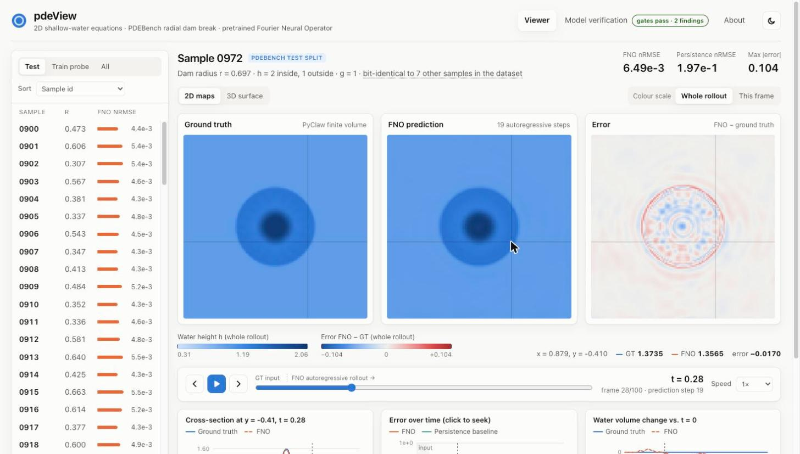

# pdeView

**An interactive viewer for 2D shallow-water equation solutions. It compares PDEBench ground truth with a
pretrained Fourier Neural Operator (FNO) that is checked for accuracy before it is used.**



pdeView loads PDEBench's *radial dam break* simulations (`2D_rdb_NA_NA`) and the published FNO checkpoint
(`2D_rdb_NA_NA_FNO.pt`). It rolls the model out autoregressively from the first 10 frames and shows prediction
and ground truth side by side:

- **Synchronised maps** of ground truth, FNO prediction and signed error. A shared crosshair reads out values,
  and the colour scale can span the whole rollout or the current frame.
- **Time scrubber** with play, step and speed controls. It marks the ground-truth input frames apart from the
  91-step FNO rollout.
- **3D water surface** (three.js) for either ground truth or FNO.
- **Diagnostic charts**: a cross-section that follows the hovered row, nRMSE over time against a persistence
  baseline (click to seek), and the change in water volume.
- **Model verification tab** showing the full checkpoint audit described below.

## The checkpoint was verified before use

The task said the pretrained checkpoints *"need to be verified before use"*. `scripts/verify_checkpoint.py` does
that and writes [`reports/VERIFICATION.md`](reports/VERIFICATION.md).

| | Result |
|---|---|
| Integrity | MD5 matches the DaRUS metadata. The state dict loads **strictly** into PDEBench's `FNO2d(modes=12, width=20, initial_step=10)` (465,557 parameters, epoch 460). |
| Accuracy vs. paper | On PDEBench's test split (samples 0900–0999), evaluated with PDEBench's own aggregation: **nRMSE 5.13e-3 vs. 4.4e-3 in the paper (1.17×)**. All eight metrics are within 1.17–1.74× of the paper's Table 5. |
| Usefulness | **33× lower nRMSE than a persistence baseline**. No NaN or Inf over the 91-step rollouts. |
| Implementation | Our metrics match PDEBench's `metric_func` to ≤ 7e-6 relative. CPU and Apple MPS rollouts agree to 2e-5. Every alternative coordinate-grid convention makes the model 1.3× to 760× worse, which confirms the input layout. |

**All accuracy gates pass, so the model is used in the viewer.** The audit also turned up two things that
anyone using this checkpoint or benchmark should know:

1. **The test split does not measure generalisation.** The depth is set per grid cell, so every radius between
   two cell-centre distances gives the *same* discrete initial condition, and PyClaw is deterministic. The 1000
   samples contain only **81 distinct trajectories**, which is every initial condition the 128 × 128 grid allows
   for r ∈ [0.3, 0.7]. **All 100 test samples are bit-identical to a training sample**
   (`scripts/audit_dataset.py`).
2. **The validation loss stored in the checkpoint does not reproduce.** Recomputing it from our rollouts gives
   2.17× the stored value. Training horizon, grid convention and split are ruled out. The checkpoint (June 2022)
   predates the data release (July 2022), so it was probably trained on an earlier revision of the data.

## Quick start

Requirements: [uv](https://docs.astral.sh/uv/) and Node 20+.

```bash
uv sync                                    # Python 3.12 environment
uv run python scripts/fetch_data.py        # checkpoint (11 MB, MD5-checked) + 110 samples (~730 MB, ~2 min)
uv run python scripts/verify_checkpoint.py # optional: re-run the verification (~2.5 min on CPU)

# development: API on :8000, Vite dev server on :5173 (proxies /api)
uv run uvicorn pdeview.api.app:app --port 8000
cd frontend && npm install && npm run dev

# production-style: build the frontend once; FastAPI serves it
cd frontend && npm run build && cd ..
uv run pdeview-serve                       # http://localhost:7860
```

Or with Docker (CPU-only PyTorch; assets are downloaded on first start into named volumes):

```bash
docker compose up --build                  # http://localhost:8000
```

### Partial download over HTTP

The full PDEBench SWE file is 6.2 GB. pdeView needs only the test split (and 10 training samples for the audit).
`backend/pdeview/data/remote.py` opens the remote HDF5 file through fsspec and reads **only the metadata** of
the groups it needs. Every dataset in the file is contiguous and uncompressed, so it then downloads each
sample's 6.6 MB block with **one HTTP Range request**. Each sample is checked on arrival: shape, finite values,
physical range, and that the initial-condition radius matches the sample's generator config. The download can
be resumed.

## Architecture

```
 DaRUS (PDEBench data + checkpoints)
        │  HTTP Range reads (fsspec + h5py metadata)    MD5-checked download
        ▼                                                 ▼
 data/swe_subset.h5  ───────────►  ViewerService  ◄───  checkpoints/2D_rdb_NA_NA_FNO.pt
                                   │  FNO2d (PyTorch, strict load)
                                   │  autoregressive rollout + LRU cache
                                   │  metrics (RMSE, nRMSE, cRMSE, max, bRMSE, fRMSE)
                                   ▼
                     FastAPI  /api/meta  /api/samples  /api/samples/{id}/field?kind=gt|pred
                              /api/samples/{id}/stats  /api/verification
                                   │  float32 arrays as binary (gzip), JSON stats
                                   ▼
                     React + TypeScript (Vite) ─ canvas heat maps · three.js surface · SVG charts
```

| Path | Purpose |
|---|---|
| `backend/pdeview/model/fno.py` | FNO2d, parameter-compatible with PDEBench (adapted from PDEBench, MIT) |
| `backend/pdeview/model/checkpoint.py` | MD5 check, strict load, checkpoint metadata |
| `backend/pdeview/inference.py` | Autoregressive rollout and persistence baseline |
| `backend/pdeview/metrics.py` | Our own implementation of PDEBench's metric definitions, plus a PDEBench-compatible aggregation mode |
| `backend/pdeview/data/remote.py` | Resumable partial download with Range requests |
| `backend/pdeview/data/audit.py` | Finds duplicated trajectories across all 1000 samples |
| `backend/pdeview/verification.py` | Verification checks (gates and findings) |
| `backend/pdeview/service.py`, `api/app.py` | Rollout cache and HTTP API |
| `frontend/src` | Viewer UI |
| `reports/` | Generated verification report, dataset audit and figures |

## API

| Endpoint | Returns |
|---|---|
| `GET /api/meta` | Grid, times, physics, model card, verification summary |
| `GET /api/samples` | Samples with dam radius, FNO error and duplicate count |
| `GET /api/samples/{id}/field?kind=gt\|pred` | `float32[101,128,128]`, little-endian, `X-Shape` header |
| `GET /api/samples/{id}/stats` | Per-frame RMSE, nRMSE and max error, persistence nRMSE, water volume |
| `GET /api/verification` | Full verification report (JSON) |

## Tests

```bash
uv run pytest            # model, metrics (closed-form cases), data checks, API
uv run ruff check .
cd frontend && npm run build   # type-check + bundle
```

## Attribution

- Data and pretrained model: **PDEBench** (Takamoto et al., *PDEBench: An Extensive Benchmark for Scientific
  Machine Learning*, NeurIPS 2022 Datasets & Benchmarks). DaRUS
  [doi:10.18419/darus-2986](https://doi.org/10.18419/darus-2986) and
  [doi:10.18419/darus-2987](https://doi.org/10.18419/darus-2987), CC BY 4.0. They are downloaded at runtime and
  not redistributed here.
- FNO: Li et al., *Fourier Neural Operator for Parametric Partial Differential Equations*, ICLR 2021. The
  architecture is adapted from PDEBench's MIT-licensed `fno.py`.
- The metrics are our own implementation of PDEBench's definitions. No code was taken from PDEBench's
  non-commercial `metrics.py`.

Code: MIT License (see `LICENSE`).
