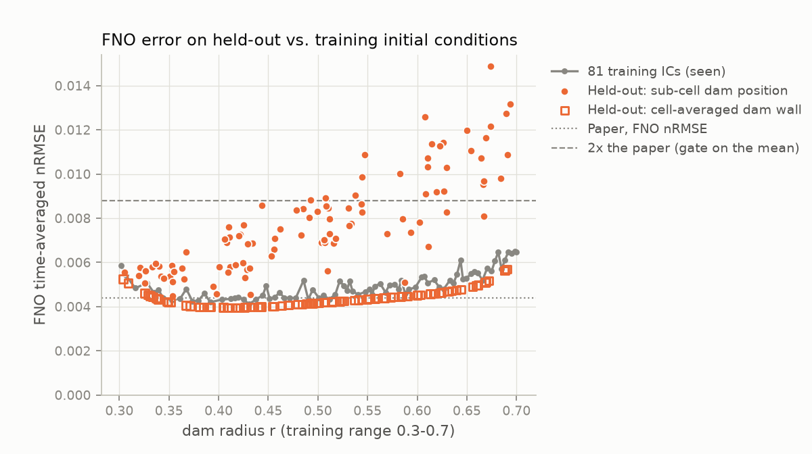
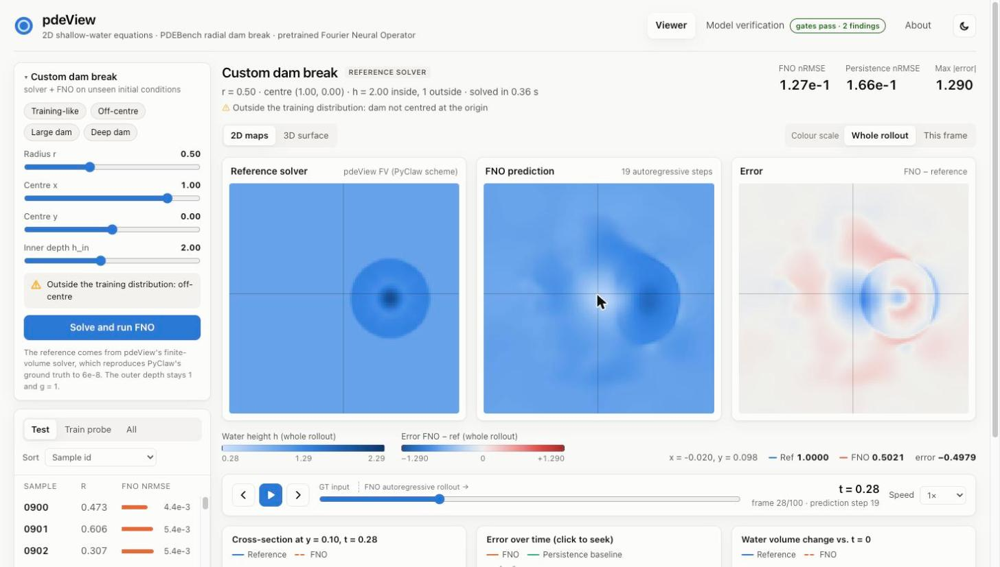

# pdeView

**An interactive viewer for 2D shallow-water equation solutions. It compares PDEBench ground truth with a
pretrained Fourier Neural Operator (FNO) that is checked for accuracy before it is used.**


pdeView loads PDEBench's *radial dam break* simulations (`2D_rdb_NA_NA`) and the published FNO checkpoint
(`2D_rdb_NA_NA_FNO.pt`). It rolls the model out autoregressively from the first 10 frames and shows prediction
and ground truth side by side:

- **Synchronised maps** of ground truth, FNO prediction and signed error. A shared crosshair reads out values,
  and the colour scale can span the whole rollout or the current frame.
- **Time scrubber** with play, step and speed controls. It marks the ground-truth input frames apart from the
  91-step FNO rollout.
- **3D water surface** (three.js) for either ground truth or FNO.
- **Diagnostic charts**: a cross-section that follows the hovered row, nRMSE over time against a persistence
  baseline (click to seek), and the change in water volume.
- **Custom dam breaks**: set the radius, centre and depth. pdeView's own finite-volume solver (which reproduces
  PyClaw's ground truth to 6e-8) computes the reference, and the FNO is rolled out on it live. This shows where
  the model stops generalising.
- **Held-out test cases**: 200 new in-distribution dam breaks generated with PyClaw, none of which occurs in
  PDEBench's training split. Browse them in the sample list under *Held-out*.
- **Model verification tab** showing the full checkpoint audit, the held-out test and the generalisation study
  described below.

## Live demo (static)

**<https://mshibashish.github.io/pdeView/>** is a static build of the viewer on GitHub Pages. No server is
involved:

- **Precomputed in CI:** every sample (test split, training probe and held-out cases), its statistics, the
  reports and the figures. The FNO predictions are rolled out with PyTorch at build time.
- **In your browser:** custom dam breaks. A JavaScript port of the solver computes the reference, and the FNO,
  exported to ONNX, is rolled out with onnxruntime-web.

The ground-truth fields are exact copies of the PDEBench and PyClaw data. To keep the site small, the predictions
are quantised to 16 bits, which changes them by less than 1.5e-5 in *h* (the exact bound is in the site's `manifest.json`), far below
the FNO's own error.

How it differs from the full app:
- Predictions are precomputed and quantised instead of rolled out live in PyTorch.
- Custom dam breaks run on your device in JavaScript and WebAssembly, so they can take longer than on a server.
  They are kept in memory only and are gone after a reload.
- In the browser the model runs in ONNX Runtime. The export is checked to match PyTorch to within 1e-4 over a
  full rollout.

For the full app, follow the [quick start](#quick-start) to run it locally, or use Docker. The static build
lives on the [`pages`](https://github.com/mshibashish/pdeView/tree/pages) branch, and
[`docs/static-site.md`](https://github.com/mshibashish/pdeView/blob/pages/docs/static-site.md) there describes
how it is made.

## The checkpoint was verified before use

The task said the pretrained checkpoints *"need to be verified before use"*. `scripts/verify_checkpoint.py` does
that and writes [`reports/VERIFICATION.md`](reports/VERIFICATION.md).

| | Result |
|---|---|
| Integrity | MD5 matches the DaRUS metadata. The state dict loads **strictly** into PDEBench's `FNO2d(modes=12, width=20, initial_step=10)` (465,557 parameters, epoch 460). |
| Accuracy vs. paper | On PDEBench's test split (samples 0900–0999), evaluated with PDEBench's own aggregation: **nRMSE 5.13e-3 vs. 4.4e-3 in the paper (1.17×)**. All eight metrics are within 1.17–1.74× of the paper's Table 5. |
| Usefulness | **33× lower nRMSE than a persistence baseline**. No NaN or Inf over the 91-step rollouts. |
| Implementation | Our metrics match PDEBench's `metric_func` to ≤ 7e-6 relative. CPU and Apple MPS rollouts agree to 2e-5. Every alternative coordinate-grid convention makes the model 1.3× to 760× worse, which confirms the input layout. |

**All accuracy gates pass, so the model is used in the viewer.** The audit also turned up two things that
anyone using this checkpoint or benchmark should know:

1. **The test split does not measure generalisation.** The depth is set per grid cell, so every radius between
   two cell-centre distances gives the *same* discrete initial condition, and PyClaw is deterministic. The 1000
   samples contain only **81 distinct trajectories**, which is every initial condition the 128 × 128 grid allows
   for r ∈ [0.3, 0.7]. **All 100 test samples are bit-identical to a training sample**
   (`scripts/audit_dataset.py`).
2. **The validation loss stored in the checkpoint does not reproduce.** Recomputing it from our rollouts gives
   2.17× the stored value. Training horizon, grid convention and split are ruled out. The checkpoint (June 2022)
   predates the data release (July 2022), so it was probably trained on an earlier revision of the data.

### Is it accurate on unseen in-distribution data? Yes

Finding 1 means PDEBench's generator *cannot* produce unseen data: the training split already contains all 81
initial conditions it can make. `scripts/heldout_eval.py` keeps the physical specification (a centred circular
dam, r ~ U(0.3, 0.7), h = 2 inside and 1 outside) and discretises it in two ways that never reproduce a training
IC. The reference trajectories come from **PyClaw itself**, configured as PDEBench
(`scripts/pyclaw_reference.py`), which reproduces all 110 downloaded samples **bit for bit**
([`reports/HELDOUT.md`](reports/HELDOUT.md)):

| Held-out set (n) | Differs from training by | FNO nRMSE (95 % CI) | PDEBench aggr. vs. paper | Persistence |
|---|---|---|---|---|
| Sub-cell dam position (100) | centre drawn within half a cell of the origin, which the grid cannot resolve | 7.8e-3 [7.4e-3, 8.2e-3] | 8.2e-3, **1.86×** | 0.16 (21× worse) |
| Cell-averaged dam wall (100) | cut cells hold the fraction of water inside the wall | 4.4e-3 [4.3e-3, 4.4e-3] | 4.6e-3, **1.05×** | 0.16 (37× worse) |
| *Control: all 81 training ICs* | nothing | 4.8e-3 [4.7e-3, 5.0e-3] | — | 0.16 |

**All gates pass on both sets, so the model is satisfactorily accurate in distribution.** The same thresholds as
above apply: nRMSE within 2× of the paper, every metric within 10×, at least 10× better than persistence. Two
caveats:
- The sub-cell set is 1.6× worse than the training ICs. The error grows steadily as the dam moves off the
  grid vertex that every training dam was centred on, and 28 of the 100 cases individually exceed 2× the paper.
- The distribution is so narrow that returning the nearest of the 81 training trajectories, chosen on the same
  10 input frames, does as well (7.5e-3) or better (2.5e-3). The FNO's own error (about 4.8e-3) exceeds the gap
  between neighbouring training trajectories.



### Does it generalise? Only inside the training distribution

The test split can't answer this, so `backend/pdeview/solver/swe.py` re-implements PDEBench's PyClaw setup in
NumPy: wave propagation, the Roe solver with Harten–Hyman entropy fix, the MC limiter, dimensional splitting and
PyClaw's CFL control. It **reproduces all 110 downloaded samples to max |Δh| = 6e-8**, the precision of the stored
float32 data, and matches PyClaw's float32 output bit for bit on the 200 held-out initial conditions. `scripts/generalization_study.py` then rolls the FNO out on new dam breaks
([`reports/GENERALIZATION.md`](reports/GENERALIZATION.md)):

| Initial condition | FNO nRMSE | vs. in-distribution (4.4e-3) | Persistence |
|---|---|---|---|
| r = 0.3–0.7, centred (training range) | 4.3e-3 – 6.5e-3 | 1.0–1.5× | 0.11–0.20 |
| r = 0.8 / 1.0 / 1.2 | 2.5e-2 / 0.18 / **0.47** | 6× / 40× / 106× | ~0.21 |
| dam moved off-centre by 0.1 / 0.5 / 1.0 | 2.7e-2 / 9.4e-2 / 0.13 | 6× / 21× / 29× | 0.17 |
| inner depth 1.5 / 2.5 / 3.0 (training: 2) | 3.9e-2 / 0.13 / **0.55** | 9× / 29× / 125× | 0.08–0.32 |
| two dams | 0.12–0.15 | 27–33× | 0.17–0.19 |

The FNO takes absolute coordinates as input, and every training dam was centred. For an off-centre dam it
**predicts a phantom collapse at the origin**: at (0, 0.1), t = 0.28 it gives h = 0.50 where the reference is a
flat h = 1.00. At r = 1.2 and h_in = 3 it is worse than predicting no change at all. Within its narrow training
distribution it is an accurate, fast emulator (0.3 s per rollout on Apple MPS). Outside it, the model is not
trustworthy.



## Quick start

Requirements: [uv](https://docs.astral.sh/uv/) and Node 20+.

```bash
uv sync                                    # Python 3.12 environment
uv run python scripts/fetch_data.py        # checkpoint (11 MB, MD5-checked) + 110 samples (~730 MB, ~2 min)
uv run python scripts/verify_checkpoint.py # optional: re-run the verification (~2.5 min on CPU)
uv run python scripts/heldout_eval.py      # optional: held-out test (PyClaw via uv + Python 3.13, ~12 min)
uv run python scripts/generalization_study.py  # optional: solver validation + generalisation (~2 min)

# development: API on :8000, Vite dev server on :5173 (proxies /api)
uv run uvicorn pdeview.api.app:app --port 8000
cd frontend && npm install && npm run dev

# production-style: build the frontend once; FastAPI serves it
cd frontend && npm run build && cd ..
uv run pdeview-serve                       # http://localhost:7860
```

Or with Docker (CPU-only PyTorch; assets are downloaded on first start into named volumes). The image also runs
as a Hugging Face Docker Space via `scripts/deploy_hf_space.py`, which needs a paid HF plan.

```bash
docker compose up --build                  # http://localhost:8000
```

### Partial download over HTTP

The full PDEBench SWE file is 6.2 GB. pdeView needs only the test split (and 10 training samples for the audit).
`backend/pdeview/data/remote.py` opens the remote HDF5 file through fsspec and reads **only the metadata** of
the groups it needs. Every dataset in the file is contiguous and uncompressed, so it then downloads each
sample's 6.6 MB block with **one HTTP Range request**. Each sample is checked on arrival: shape, finite values,
physical range, and that the initial-condition radius matches the sample's generator config. The download can
be resumed.

## Architecture

```
 DaRUS (PDEBench data + checkpoints)
        │  HTTP Range reads (fsspec + h5py metadata)    MD5-checked download
        ▼                                                 ▼
 data/swe_subset.h5  ───────────►  ViewerService  ◄───  checkpoints/2D_rdb_NA_NA_FNO.pt
                                   │  FNO2d (PyTorch, strict load)
                                   │  autoregressive rollout + LRU cache
                                   │  metrics (RMSE, nRMSE, cRMSE, max, bRMSE, fRMSE)
                                   ▼
                     FastAPI  /api/meta  /api/samples  /api/samples/{id}/field?kind=gt|pred
                              /api/samples/{id}/stats  /api/verification
                                   │  float32 arrays as binary (gzip), JSON stats
                                   ▼
                     React + TypeScript (Vite) ─ canvas heat maps · three.js surface · SVG charts
```

| Path | Purpose |
|---|---|
| `backend/pdeview/model/fno.py` | FNO2d, parameter-compatible with PDEBench (adapted from PDEBench, MIT) |
| `backend/pdeview/model/checkpoint.py` | MD5 check, strict load, checkpoint metadata |
| `backend/pdeview/inference.py` | Autoregressive rollout and persistence baseline |
| `backend/pdeview/metrics.py` | Our own implementation of PDEBench's metric definitions, plus a PDEBench-compatible aggregation mode |
| `backend/pdeview/data/remote.py` | Resumable partial download with Range requests |
| `backend/pdeview/data/audit.py` | Finds duplicated trajectories across all 1000 samples |
| `backend/pdeview/verification.py` | Verification checks (gates and findings) |
| `backend/pdeview/solver/swe.py` | NumPy finite-volume SWE solver equivalent to PDEBench's PyClaw setup |
| `backend/pdeview/heldout.py` | Held-out in-distribution test set: case design, PyClaw references, baselines, gates |
| `scripts/pyclaw_reference.py` | Runs PyClaw with PDEBench's configuration (own Python 3.13 environment via uv) |
| `backend/pdeview/generalization.py` | FNO evaluation on out-of-distribution initial conditions |
| `backend/pdeview/service.py`, `api/app.py` | Rollout cache and HTTP API |
| `frontend/src` | Viewer UI |
| `reports/` | Generated verification report, dataset audit and figures |

## API

| Endpoint | Returns |
|---|---|
| `GET /api/meta` | Grid, times, physics, model card, verification summary |
| `GET /api/samples` | Dataset samples and held-out cases with dam radius, FNO error and duplicate count |
| `GET /api/samples/{id}/field?kind=gt\|pred` | `float32[101,128,128]`, little-endian, `X-Shape` header |
| `GET /api/samples/{id}/stats` | Per-frame RMSE, nRMSE and max error, persistence nRMSE, water volume |
| `POST /api/simulate` | `{radius, cx, cy, h_in}` → runs the solver and the FNO; returns a key usable with the two endpoints above |
| `GET /api/verification`, `GET /api/heldout`, `GET /api/generalization` | Reports (JSON) |

## Tests

```bash
uv run pytest            # model, metrics (closed-form cases), solver, data checks, API
uv run ruff check .
cd frontend && npm run build   # type-check + bundle
```

## Attribution

- Data and pretrained model: **PDEBench** (Takamoto et al., *PDEBench: An Extensive Benchmark for Scientific
  Machine Learning*, NeurIPS 2022 Datasets & Benchmarks). DaRUS
  [doi:10.18419/darus-2986](https://doi.org/10.18419/darus-2986) and
  [doi:10.18419/darus-2987](https://doi.org/10.18419/darus-2987), CC BY 4.0. The full app downloads them at
  runtime, and this repository does not contain them. The static demo redistributes 110 ground-truth fields
  unchanged, FNO predictions derived from them (quantised), and the checkpoint converted to ONNX.
- FNO: Li et al., *Fourier Neural Operator for Parametric Partial Differential Equations*, ICLR 2021. The
  architecture is adapted from PDEBench's MIT-licensed `fno.py`.
- The metrics are our own implementation of PDEBench's definitions. No code was taken from PDEBench's
  non-commercial `metrics.py`.

[`ATTRIBUTION.md`](ATTRIBUTION.md) gives the full citations, every change made to PDEBench material, and the
licences of the frontend libraries and other third-party tools.

Code: MIT License (see `LICENSE`).
