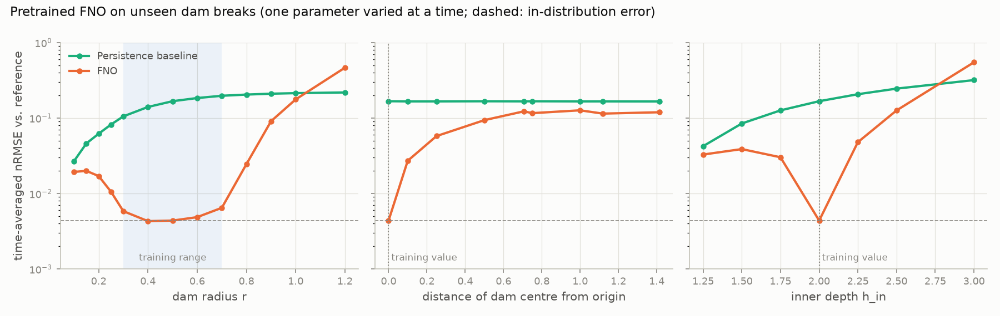
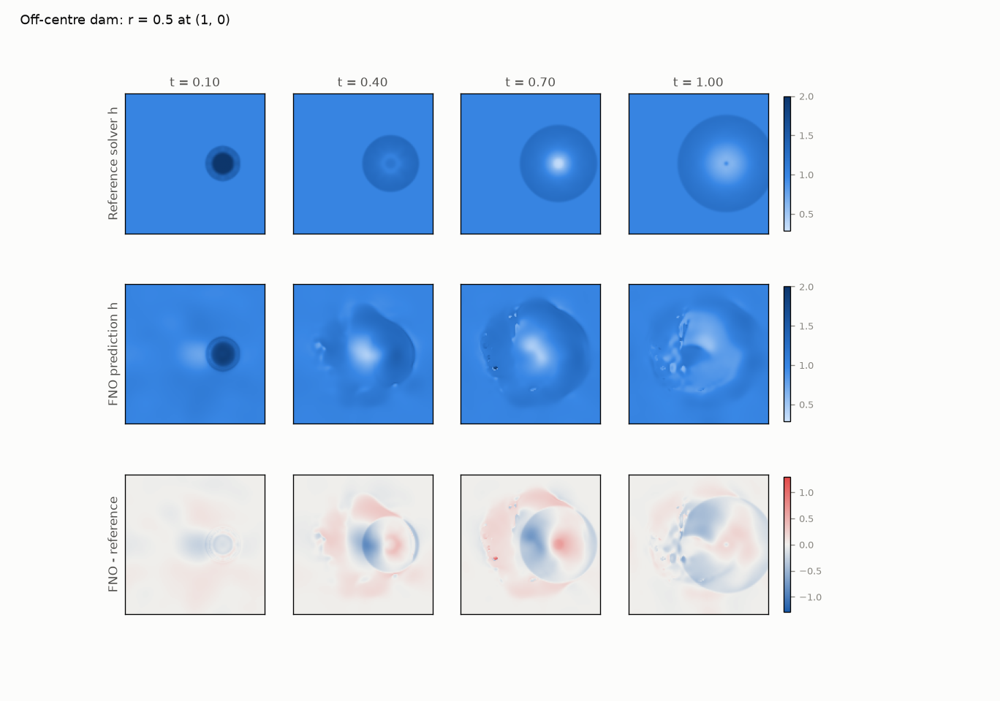
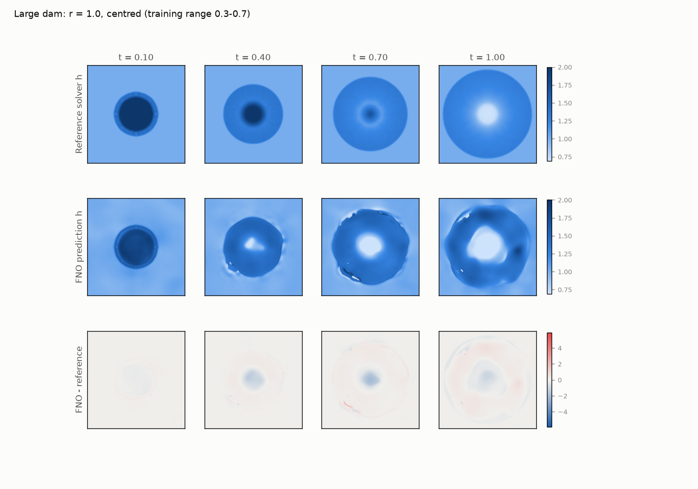
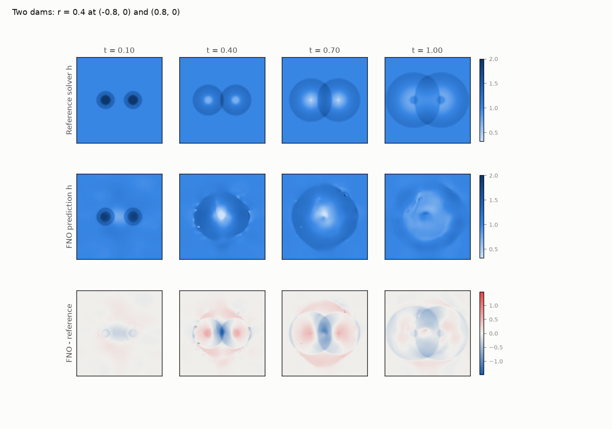

# Does the pretrained FNO generalise? (2D shallow water, radial dam break)

PDEBench's test split cannot answer this: all 100 test samples are bit-identical copies of training samples (see [VERIFICATION.md](VERIFICATION.md)). We therefore generate *new* dam breaks with our own solver and roll the FNO out from the solver's first 10 frames, exactly as on dataset samples. Generated by `scripts/generalization_study.py`.

## 1. The reference solver reproduces PyClaw

`backend/pdeview/solver/swe.py` re-implements the scheme PDEBench used (wave-propagation with Roe solver + Harten-Hyman entropy fix, MC limiter, Godunov dimensional splitting, PyClaw's CFL control, outflow boundaries). Re-simulating every downloaded sample from its generator config:

* **110 / 110 samples reproduced**; max |h - h_PyClaw| = **6.0e-08** (the float32 spacing at h = 2 is 2.4e-07, i.e. agreement to the precision of the stored data); mean nRMSE 1.5e-08.
* 0.35 s per 101-frame trajectory on one CPU core (NumPy).

So any FNO error measured against this solver is FNO error, not solver discrepancy.

## 2. Results (in-distribution reference: nRMSE 4.39e-03 for a centred r = 0.5 dam)

Skill = 1 - nRMSE_FNO / nRMSE_persistence (1 = perfect, 0 = no better than holding the last input frame, < 0 = worse).

### Dam radius (training range 0.3-0.7)

| Initial condition | FNO nRMSE | vs. in-distribution | nRMSE at t = 1 | Persistence nRMSE | Skill vs. persistence | Volume drift at t = 1 |
|---|---|---|---|---|---|---|
| r = 0.1 (OOD) | 1.94e-02 | 4.4x | 2.24e-02 | 2.70e-02 | 0.28 | -0.28 % |
| r = 0.15 (OOD) | 2.00e-02 | 4.6x | 2.52e-02 | 4.62e-02 | 0.57 | -0.25 % |
| r = 0.2 (OOD) | 1.71e-02 | 3.9x | 2.62e-02 | 6.21e-02 | 0.73 | -0.18 % |
| r = 0.25 (OOD) | 1.06e-02 | 2.4x | 1.56e-02 | 8.22e-02 | 0.87 | -0.09 % |
| r = 0.3 | 5.85e-03 | 1.3x | 5.86e-03 | 1.05e-01 | 0.94 | -0.03 % |
| r = 0.4 | 4.32e-03 | 1.0x | 4.62e-03 | 1.40e-01 | 0.97 | -0.03 % |
| r = 0.5 | 4.39e-03 | 1.0x | 4.89e-03 | 1.68e-01 | 0.97 | -0.03 % |
| r = 0.6 | 4.87e-03 | 1.1x | 5.33e-03 | 1.85e-01 | 0.97 | -0.08 % |
| r = 0.7 | 6.48e-03 | 1.5x | 1.36e-02 | 1.98e-01 | 0.97 | -0.68 % |
| r = 0.8 (OOD) | 2.46e-02 | 5.6x | 3.38e-02 | 2.05e-01 | 0.88 | -1.65 % |
| r = 0.9 (OOD) | 9.11e-02 | 20.8x | 8.24e-02 | 2.11e-01 | 0.57 | -1.16 % |
| r = 1 (OOD) | 1.77e-01 | 40.3x | 1.89e-01 | 2.14e-01 | 0.17 | +1.92 % |
| r = 1.2 (OOD) | 4.65e-01 | 106.1x | 9.25e-01 | 2.19e-01 | -1.13 | +27.28 % |

### Dam position (training: always centred at the origin; r = 0.5)

| Initial condition | FNO nRMSE | vs. in-distribution | nRMSE at t = 1 | Persistence nRMSE | Skill vs. persistence | Volume drift at t = 1 |
|---|---|---|---|---|---|---|
| centre (0, 0) | 4.39e-03 | 1.0x | 4.89e-03 | 1.68e-01 | 0.97 | -0.03 % |
| centre (0.1, 0) | 2.72e-02 | 6.2x | 2.33e-02 | 1.67e-01 | 0.84 | +0.15 % |
| centre (0.25, 0) | 5.78e-02 | 13.2x | 5.61e-02 | 1.67e-01 | 0.65 | +0.23 % |
| centre (0.5, 0) | 9.40e-02 | 21.4x | 8.92e-02 | 1.67e-01 | 0.44 | -0.28 % |
| centre (0.75, 0) | 1.16e-01 | 26.5x | 1.16e-01 | 1.67e-01 | 0.30 | -2.28 % |
| centre (1, 0) | 1.27e-01 | 28.9x | 1.26e-01 | 1.66e-01 | 0.24 | -4.05 % |
| centre (0.5, 0.5) | 1.23e-01 | 28.1x | 1.26e-01 | 1.67e-01 | 0.26 | -4.11 % |
| centre (1, 1) | 1.20e-01 | 27.3x | 1.36e-01 | 1.66e-01 | 0.28 | -1.92 % |
| centre (-1, -0.5) | 1.15e-01 | 26.2x | 1.13e-01 | 1.67e-01 | 0.31 | -4.37 % |

### Inner depth h_in (training: always 2)

| Initial condition | FNO nRMSE | vs. in-distribution | nRMSE at t = 1 | Persistence nRMSE | Skill vs. persistence | Volume drift at t = 1 |
|---|---|---|---|---|---|---|
| h_in = 1.25 | 3.29e-02 | 7.5x | 2.95e-02 | 4.25e-02 | 0.23 | -0.50 % |
| h_in = 1.5 | 3.89e-02 | 8.9x | 3.29e-02 | 8.48e-02 | 0.54 | -0.38 % |
| h_in = 1.75 | 3.03e-02 | 6.9x | 2.40e-02 | 1.27e-01 | 0.76 | -0.19 % |
| h_in = 2 | 4.39e-03 | 1.0x | 4.89e-03 | 1.68e-01 | 0.97 | -0.03 % |
| h_in = 2.25 | 4.80e-02 | 10.9x | 4.32e-02 | 2.07e-01 | 0.77 | +0.12 % |
| h_in = 2.5 | 1.26e-01 | 28.8x | 1.09e-01 | 2.46e-01 | 0.49 | +0.33 % |
| h_in = 3 | 5.49e-01 | 125.1x | 1.38e+00 | 3.19e-01 | -0.72 | +22.74 % |

### Two interacting dams (no training analogue)

| Initial condition | FNO nRMSE | vs. in-distribution | nRMSE at t = 1 | Persistence nRMSE | Skill vs. persistence | Volume drift at t = 1 |
|---|---|---|---|---|---|---|
| r = 0.4 at (-0.8, 0) + r = 0.4 at (0.8, 0) | 1.46e-01 | 33.3x | 1.35e-01 | 1.91e-01 | 0.24 | -5.01 % |
| r = 0.35 at (-0.6, -0.6) + r = 0.35 at (0.6, 0.6) | 1.20e-01 | 27.3x | 1.29e-01 | 1.71e-01 | 0.30 | -5.06 % |

## Example rollouts

