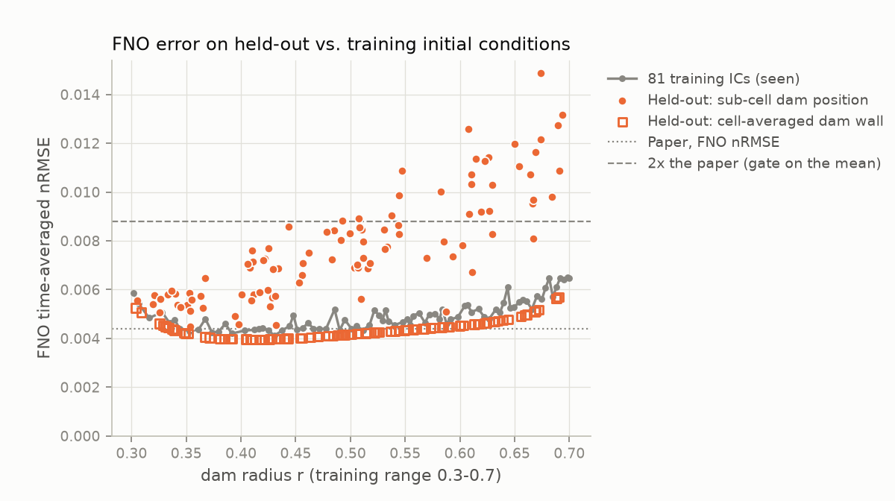
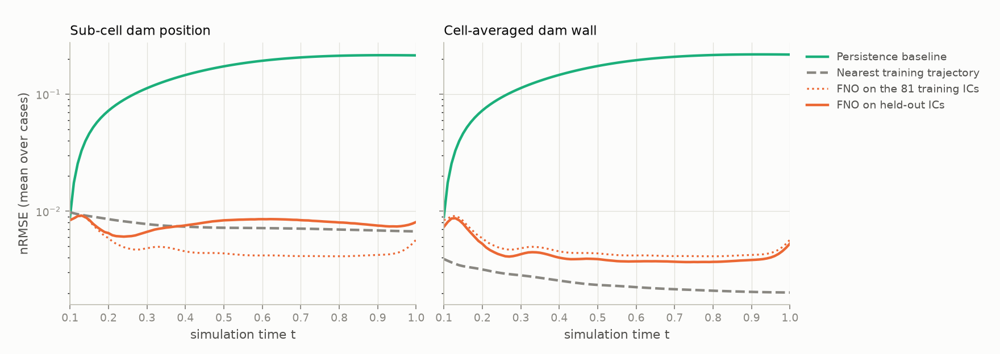
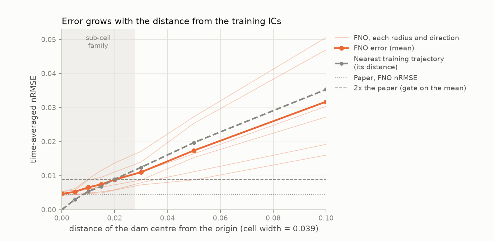
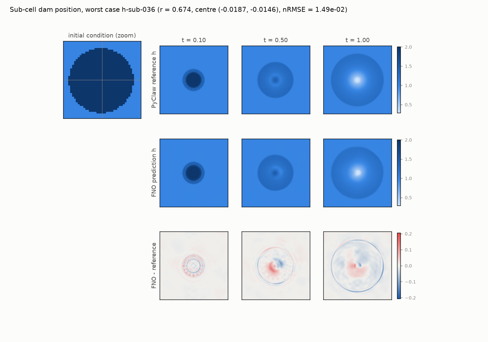

# Held-out in-distribution test of the pretrained FNO

Generated 2026-11-12T06:03:43+00:00 by `scripts/heldout_eval.py` (torch 2.15.0). Companion to [VERIFICATION.md](VERIFICATION.md) and [GENERALIZATION.md](GENERALIZATION.md).

## Summary

* **Gates: PASS.** On 200 new dam breaks that follow PDEBench's physical specification but share no trajectory with its training split, the FNO reaches nRMSE **8.20e-03** (sub-cell dam position, 1.86x the paper) and **4.60e-03** (cell-averaged dam wall, 1.05x the paper), PDEBench aggregation. That is 21x and 37x better than persistence. The model is satisfactorily accurate in distribution.
* **Why new data was needed.** As r sweeps U(0.3, 0.7), the dam crosses only 80 cell-centre distance shells on the 128 x 128 grid, so PDEBench's generator can only produce **81 distinct initial conditions**, and its 900-sample training split contains all of them. Every test sample, and every sample the generator could ever add, is a copy of a training trajectory.
* **Generalisation gap.** Cell-averaged ICs: 0.90x the error on the training ICs (none). Sub-cell positions: 1.61x (moderate). The error rises steadily as the dam moves away from the exact grid vertex that every training sample was centred on (see the offset sweep). Both families stay inside the 2x gate.
* **Caveat: a lookup table does as well or better.** The distribution is so narrow that returning the nearest of the 81 training trajectories (chosen on the same 10 input frames) gives nRMSE 7.47e-03 / 2.48e-03. The FNO beats it on 46% / 1% of cases. The FNO's own emulation error (~4.8e-03, even on training ICs) is larger than the gap between neighbouring training trajectories. Its advantage is size (11 MB vs. ~540 MB for the trajectories), not accuracy.

## Test sets

All references come from PyClaw configured as PDEBench (`scripts/pyclaw_reference.py`, clawpack 5.14.0 (PDEBench SWE configuration)). That configuration reproduces **110/110 downloaded PDEBench samples bit for bit** (max |dh| = 0.0e+00). Physical setup as in training: g = 1, h_in = 2, h_out = 1, zero velocity, 128 x 128 cells on [-2.5, 2.5]^2, outputs every 0.01 up to t = 1. Frames 0-9 are given to the FNO; metrics cover frames 10-100.

| Set | n | Radius | Centre | Dam wall | Differs from training by |
|---|---|---|---|---|---|
| Sub-cell dam position | 100 | U(0.3, 0.7) | uniform in the half-cell square around the origin (abs(cx), abs(cy) <= 0.0195) | sharp (cell centre inside -> h = 2) | which cells the wall cuts; the IC is not 8-fold symmetric |
| Cell-averaged dam wall | 100 | U(0.3, 0.7) | origin | cell average (16x16 sub-samples) | cut cells hold 1 + the fraction inside the wall |
| All 81 training ICs (control) | 81 | one per distance shell, weighted by its probability | origin | sharp | nothing: these *are* the training ICs |
| Centre-offset sweep | 48 | 0.35, 0.5, 0.65 | offset 0-0.1 along x or the diagonal | sharp | bridges to the off-centre study in GENERALIZATION.md |

Random draws use seed 20261112. A centre offset too small to move any cell centre across the dam wall reproduces a training IC exactly. 2 such draw(s) were rejected and redrawn, so none of the 200 held-out ICs equals a training IC or another held-out IC (checked by hash).

## Results

| Set | FNO nRMSE (mean, 95 % CI) | PDEBench aggr. | x paper | Median / max | Persistence | Nearest-trajectory lookup | Distance to training set |
|---|---|---|---|---|---|---|---|
| Sub-cell dam position | 7.79e-03 [7.37e-03, 8.23e-03] | 8.20e-03 | 1.86 | 7.30e-03 / 1.49e-02 | 1.61e-01 | 7.47e-03 | 7.45e-03 |
| Cell-averaged dam wall | 4.37e-03 [4.30e-03, 4.45e-03] | 4.60e-03 | 1.05 | 4.31e-03 / 5.70e-03 | 1.62e-01 | 2.48e-03 | 2.35e-03 |
| All 81 training ICs (probability-weighted) | 4.85e-03 [4.73e-03, 4.98e-03] | - | 1.10 | 4.80e-03 / 6.49e-03 | 1.61e-01 | 0.00e+00 | 0.00e+00 |

The 2x gate applies to the mean. Individually, 28/100 sub-cell cases and 0/100 cell-averaged cases exceed 2x the paper. Sub-cell errors grow with the radius, because a larger wall cuts more cells asymmetrically: the mean is 1.06e-02 for r > 0.6 vs. 4.88e-03 for cell-averaged dams of the same size. In the PDEBench aggregation the sub-cell set's low-frequency error (fRMSE low) is 5.0x the paper, the only metric above 3x. The FNO misplaces the slow central depression when the dam is not symmetric about the grid vertex (see the worst case below).

*Distance to training set* is the nRMSE between a case's reference and the closest training trajectory (frames 10-100); it is 0 for the training ICs. *Lookup* picks a training trajectory by the input frames only, as a model would have to.

## Gates (must pass to call the model accurate in distribution)

Same thresholds as the main verification.

| # | Set | Check | Result | Criterion | |
|---|---|---|---|---|---|
| 1 | all | Reference generator reproduces PDEBench's data bit for bit | `110/110 samples identical` (generator: clawpack 5.14.0 (PDEBench SWE configuration)) | all identical | PASS |
| 2 | Sub-cell dam position | Initial conditions differ from all 81 training ICs | `0/100 coincide` | 0 coincide | PASS |
| 3 | Sub-cell dam position | Predictions are finite | `True` | no NaN/Inf | PASS |
| 4 | Sub-cell dam position | nRMSE (PDEBench aggregation) within 2x of the paper | `0.008199` (ratio 1.86) | 4.4e-03 x [0.5, 2] | PASS |
| 5 | Sub-cell dam position | All other metrics within an order of magnitude of the paper | `RMSE 1.90, nRMSE 1.86, cRMSE 2.30, max_error 2.90, bRMSE 1.29, fRMSE_low 5.04, fRMSE_mid 2.63, fRMSE_high 1.35` | ratio in [0.1, 10] | PASS |
| 6 | Sub-cell dam position | Beats the persistence baseline by >= 10x in nRMSE | `20.62` (persistence nRMSE 1.606e-01) | >= 10 | PASS |
| 7 | Cell-averaged dam wall | Initial conditions differ from all 81 training ICs | `0/100 coincide` | 0 coincide | PASS |
| 8 | Cell-averaged dam wall | Predictions are finite | `True` | no NaN/Inf | PASS |
| 9 | Cell-averaged dam wall | nRMSE (PDEBench aggregation) within 2x of the paper | `0.004599` (ratio 1.05) | 4.4e-03 x [0.5, 2] | PASS |
| 10 | Cell-averaged dam wall | All other metrics within an order of magnitude of the paper | `RMSE 1.06, nRMSE 1.04, cRMSE 1.42, max_error 1.63, bRMSE 1.15, fRMSE_low 1.21, fRMSE_mid 0.89, fRMSE_high 1.15` | ratio in [0.1, 10] | PASS |
| 11 | Cell-averaged dam wall | Beats the persistence baseline by >= 10x in nRMSE | `37.15` (persistence nRMSE 1.623e-01) | >= 10 | PASS |

## Findings

| # | Set | Check | Result | Expected | |
|---|---|---|---|---|---|
| 1 | Sub-cell dam position | Error on unseen ICs matches the error on training ICs | 1.607 (7.79e-03 vs 4.85e-03 on the 81 training ICs) | <= 1.25x | **ISSUE** |
| 2 | Sub-cell dam position | Beats a lookup of the nearest training trajectory | 0.007472 (FNO better on 46% of cases) | > FNO nRMSE 7.79e-03 | **ISSUE** |
| 3 | Cell-averaged dam wall | Error on unseen ICs matches the error on training ICs | 0.9014 (4.37e-03 vs 4.85e-03 on the 81 training ICs) | <= 1.25x | OK |
| 4 | Cell-averaged dam wall | Beats a lookup of the nearest training trajectory | 0.002483 (FNO better on 1% of cases) | > FNO nRMSE 4.37e-03 | **ISSUE** |

## All metrics vs. the paper (PDEBench aggregation)

| Metric | Paper (Table 5) | Sub-cell dam position | x paper | Cell-averaged dam wall | x paper |
|---|---|---|---|---|---|
| RMSE | 4.50e-03 | 8.54e-03 | 1.90 | 4.78e-03 | 1.06 |
| nRMSE | 4.40e-03 | 8.20e-03 | 1.86 | 4.60e-03 | 1.05 |
| cRMSE | 2.00e-04 | 4.60e-04 | 2.30 | 2.84e-04 | 1.42 |
| max_error | 4.50e-02 | 1.30e-01 | 2.90 | 7.35e-02 | 1.63 |
| bRMSE | 1.40e-03 | 1.80e-03 | 1.29 | 1.61e-03 | 1.15 |
| fRMSE_low | 2.60e-04 | 1.31e-03 | 5.04 | 3.14e-04 | 1.21 |
| fRMSE_mid | 3.10e-04 | 8.15e-04 | 2.63 | 2.77e-04 | 0.89 |
| fRMSE_high | 2.50e-04 | 3.38e-04 | 1.35 | 2.87e-04 | 1.15 |

## Offset sweep

Mean FNO nRMSE over 3 radii x 2 directions, by distance of the dam centre from the origin: 0: 4.65e-03, 0.005: 5.25e-03, 0.01: 6.56e-03, 0.015: 7.45e-03, 0.02: 8.81e-03, 0.03: 1.10e-02, 0.05: 1.74e-02, 0.1: 3.17e-02. The sub-cell family stays below 0.0276. The error tracks the distance to the nearest training trajectory, which is what you would expect from a model that interpolates between the 81 training trajectories rather than one that has learned translation-invariant dynamics. The FNO also receives absolute coordinates as input, so it is not translation-equivariant by construction.

## Side result: pdeview's solver on the held-out ICs

The custom dam breaks in the viewer use pdeview's own NumPy solver. On the 200 held-out ICs (asymmetric and fractional, a configuration it was not validated on before) it reproduces PyClaw's float32 output bit for bit.

## Figures









## Reproduce

```bash
uv run python scripts/fetch_data.py      # PDEBench subset + checkpoint
uv run python scripts/heldout_eval.py    # PyClaw references (uv, Python 3.13) + evaluation
```

References are cached in `data/heldout/references.h5`. Runtime here: 580 s.
