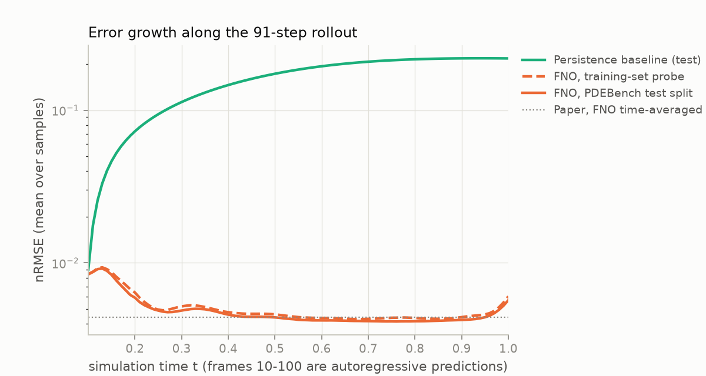
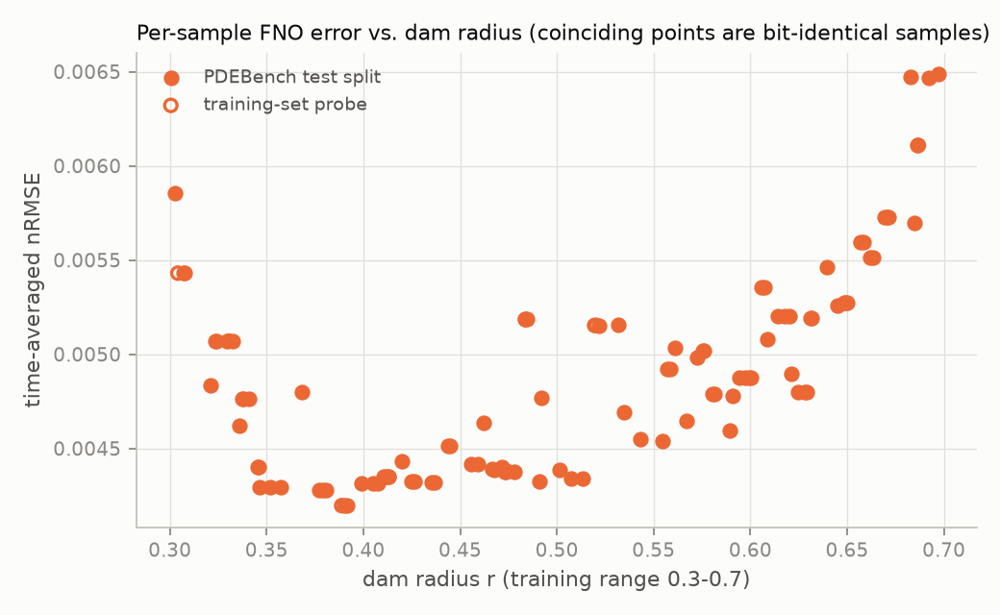
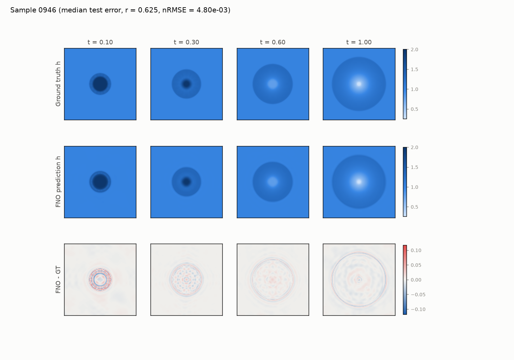
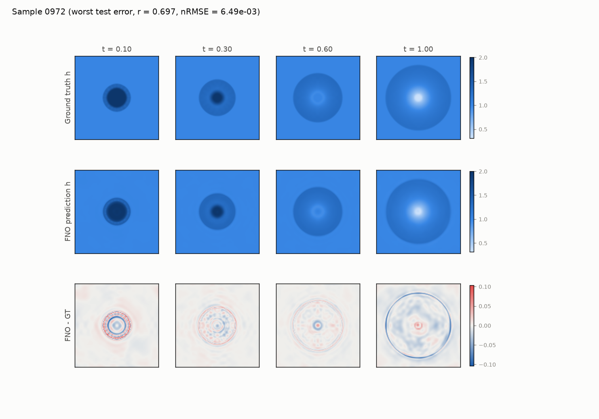

# Pretrained FNO verification - 2D shallow-water equations (PDEBench `2D_rdb_NA_NA`)

Generated 2026-11-11T19:47:39+00:00 by `scripts/verify_checkpoint.py` (torch 2.15.0, Darwin arm64).

## Summary

* **Gates: PASS.** The DaRUS checkpoint is intact, loads strictly into PDEBench's FNO architecture and, run as PDEBench runs it, reaches nRMSE 5.13e-03 on PDEBench's test split (1.17x the paper's 4.4e-03; all metrics 1.17-1.74x the paper) and is 33x better than a persistence baseline. It is used in the viewer.
* **Finding 1 - the test split does not measure generalisation.** The 1000 samples contain only **81 distinct trajectories**; **100/100 test samples are bit-identical to a training sample.** The reported accuracy is accuracy on trajectories the model was trained on.
* **Finding 2 - the checkpoint's stored validation loss is not reproducible** (2.17x higher when recomputed), and the checkpoint is somewhat less accurate than the paper's table, suggesting it was trained/evaluated on a different revision of the data or pipeline than the one published.

## Gates (must pass to use the model)

| # | Check | Result | Criterion | |
|---|---|---|---|---|
| 1 | Checkpoint MD5 matches DaRUS metadata | `e75d87abd5f6a7b777cb2f0e6a3a05c4` | e75d87abd5f6a7b777cb2f0e6a3a05c4 | PASS |
| 2 | State dict loads strictly into FNO2d(modes=12, width=20, initial_step=10) | `465557` | all keys & shapes match | PASS |
| 3 | Downloaded samples are valid dam breaks on the documented grid | `0` | 0 issues | PASS |
| 4 | Ground truth conserves volume (waves stay inside the domain) | `1.179e-09` | < 1e-4 relative | PASS |
| 5 | Predictions are finite | `True` | no NaN/Inf | PASS |
| 6 | nRMSE (PDEBench aggregation) within 2x of the paper | `0.005127` (ratio 1.17) | 4.4e-03 x [0.5, 2] | PASS |
| 7 | All other metrics within an order of magnitude of the paper | `RMSE 1.19, nRMSE 1.17, cRMSE 1.52, max_error 1.74, bRMSE 1.19, fRMSE_low 1.31, fRMSE_mid 1.21, fRMSE_high 1.23` | ratio in [0.1, 10] | PASS |
| 8 | Beats the persistence baseline by >= 10x in nRMSE | `33.24` (persistence nRMSE 1.619e-01) | >= 10 | PASS |

## Findings (properties users of the model must know)

| # | Check | Result | Expected | |
|---|---|---|---|---|
| 1 | Reproduces the validation loss stored in the checkpoint | 0.0005575 (2.17x the stored value) | within 1 % of 2.569744e-04 | **ISSUE** |
| 2 | Test split is disjoint from the training split | 100/100 test samples have a bit-identical training trajectory (1000 samples contain only 81 distinct trajectories) | 0 shared trajectories | **ISSUE** |

## Metrics vs. the PDEBench paper

PDEBench test split = the last 10 % of sorted sample keys (`0900`-`0999`, 100 samples), as in PDEBench's default FNO loader. Frames 0-9 are ground-truth input; metrics cover the 91 autoregressive predictions (frames 10-100).

* **PDEBench aggregation** reproduces the paper's evaluation loop (per-batch metrics, batch size 5, summed and divided by `n_batches - 1`) - the like-for-like comparison.
* **Clean** aggregates all 100 samples as one population (no off-by-one; `max error`, `cRMSE` and `fRMSE` taken over all samples rather than per batch of 5).
* **Dedup** keeps one sample per distinct trajectory (58 of 100).

| Metric | Paper (Table 5) | Ours, PDEBench aggr. | Ratio | Ours, clean | Ours, dedup | Persistence (clean) | Train probe (clean) |
|---|---|---|---|---|---|---|---|
| RMSE | 4.50e-03 | 5.34e-03 | 1.19 | 5.07e-03 | 5.15e-03 | 1.69e-01 | 5.28e-03 |
| nRMSE | 4.40e-03 | 5.13e-03 | 1.17 | 4.87e-03 | 4.94e-03 | 1.62e-01 | 5.07e-03 |
| cRMSE | 2.00e-04 | 3.05e-04 | 1.53 | 3.13e-04 | 3.38e-04 | 2.90e-10 | 3.20e-04 |
| max_error | 4.50e-02 | 7.83e-02 | 1.74 | 1.10e-01 | 1.10e-01 | 1.44e+00 | 1.01e-01 |
| bRMSE | 1.40e-03 | 1.67e-03 | 1.19 | 1.59e-03 | 1.64e-03 | 0.00e+00 | 1.69e-03 |
| fRMSE_low | 2.60e-04 | 3.40e-04 | 1.31 | 3.34e-04 | 3.56e-04 | 3.43e-02 | 3.59e-04 |
| fRMSE_mid | 3.10e-04 | 3.75e-04 | 1.21 | 3.62e-04 | 3.74e-04 | 1.03e-02 | 3.79e-04 |
| fRMSE_high | 2.50e-04 | 3.07e-04 | 1.23 | 2.95e-04 | 2.98e-04 | 1.28e-03 | 3.01e-04 |

## Checkpoint

* File `2D_rdb_NA_NA_FNO.pt`, MD5 `e75d87abd5f6a7b777cb2f0e6a3a05c4` (DaRUS: `e75d87abd5f6a7b777cb2f0e6a3a05c4`).
* Keys ['epoch', 'loss', 'model_state_dict', 'optimizer_state_dict']; saved at epoch **460** of 500; optimizer LR at save 6.25e-05 (= 1e-3 x 0.5^4, consistent with StepLR(100, 0.5) after epoch 400).
* 465,557 parameters (926,357 real numbers); hyper-parameters {'num_channels': 1, 'modes': 12, 'width': 20, 'initial_step': 10}.

## Finding 1: duplicated trajectories (train/test leakage)

Each sample is a centred dam break whose only parameter is the radius r ~ U(0.3, 0.7). The initial depth is assigned per cell (h = 2 where the cell centre lies within r), so every radius between two consecutive cell-centre distances yields the *same* discrete initial condition - and PyClaw is deterministic. On the 128 x 128 grid, r in [0.3, 0.7] crosses only 80 distance shells, i.e. 81 possible initial conditions, all of which occur.

* `scripts/audit_dataset.py` reads the `config` of all 1000 samples remotely: 81 distinct trajectories, each repeated 1-38 times (median 11). Training covers 81, test 58 - **every** test trajectory is in the training set.
* Confirmed on the downloaded data: within the 110 local samples, 79 pairs are bit-identical, and the initial-condition signature predicts bit-identity for every pair: True.
* Consequences: (i) test metrics measure how well the FNO reproduces training trajectories, not generalisation; (ii) the train-probe vs. test comparison is uninformative (ratio 1.04); (iii) PDEBench selects the saved checkpoint on this same test split. Genuine generalisation can only be probed with *new* simulations (e.g. off-centre dams or radii outside the training range), which requires an independent solver.

## Finding 2: stored validation loss

PDEBench saves the best validation loss in the checkpoint (`loss`: per-batch MSE over frames 10..100, summed over the 20 batches of the test split).

* Stored: `2.569744e-04`; recomputed from our rollouts: `5.575331e-04` (2.17x).
* Shorter training horizons do not explain it (the error is largest early in the rollout): t_train=20: 1.45e-03, t_train=30: 1.01e-03, t_train=50: 7.49e-04, t_train=70: 6.30e-04, t_train=90: 5.68e-04, t_train=101: 5.58e-04.
* The coordinate-grid convention is not the cause - every alternative is worse (MSE relative to ours, 10 samples): cell centres, ij (used): 1.00x, cell nodes linspace(-2.5, 2.5): 1.30x, x/y channels swapped: 757.23x, unit square [0, 1]: 725.15x.
* The split is not the cause (all test trajectories also appear in training).
* The published SWE data also differs from the current PDEBench generator (radii are not `default_rng(seed).uniform(0.3, 0.7)`), and the checkpoint (DaRUS 2022-06-21) predates the data release (2022-07-26). The most plausible explanation is that the checkpoint was trained on an earlier data/pipeline revision; this cannot be verified from public artefacts, so it is reported as an open discrepancy.

## Other notes

* PDEBench's `metrics()` divides summed per-batch errors by the last batch *index* (19 instead of 20 batches), inflating reported values by ~5 %; the *clean* column removes this. Its `max error` is the mean over time of the per-batch worst case, so it depends on batch size.
* Ground-truth water volume is conserved to 1.2e-09 (waves never reach the outflow boundary before t = 1); the FNO is not conservative by construction - its volume error is the `cRMSE` metric.
* The FNO error is concentrated at the moving bore (ringing from the 12-mode spectral truncation of a near-discontinuity) and is largest early in the rollout, when the front is sharpest, and for the largest radii.
* Inference: 1.43 s per 91-step rollout on CPU (batched), 0.32 s on Apple MPS (single sample); MPS vs. CPU max abs difference 1.9e-05.
* Our metric implementation was cross-checked against PDEBench's `metric_func` on the same predictions: all eight metrics agree to <= 7e-6 relative (float32 round-off).

## Figures

